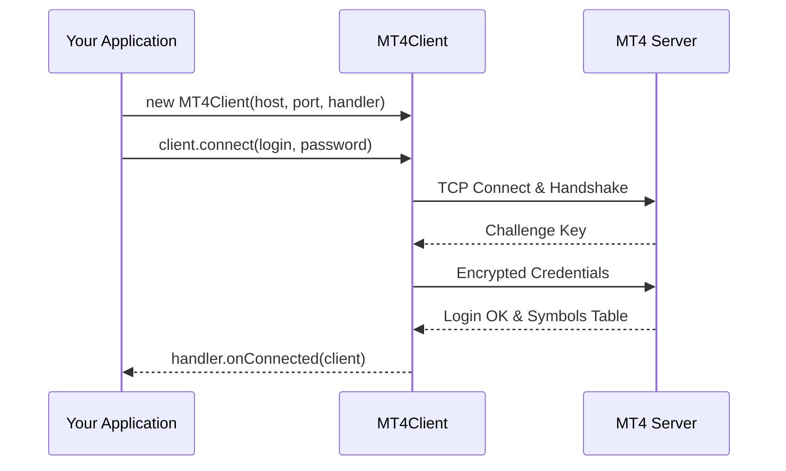

# Connection

## MT4Account (MRPC)

```java
MT4Account account = new MT4Account("your-api-key");            // mt4.mrpc.pro:443
String terminal = account.connect(7689280, "your-password", "TeleTrade-Demo", 120);

// ... calls ...

account.disconnect(false);   // true: stop the terminal and delete it
account.close();             // the channel
```

`connect()` returns once the terminal is connected and throws `MrpcException` when the server refuses (wrong password,
unknown server, ...). `connect(user, password, host, port, timeoutSeconds)` connects by the address of the broker's MT4
server instead of its name.

There is no automatic reconnect: when a call throws `TERMINAL_INSTANCE_NOT_FOUND` or the channel fails, call `connect()`
again.

## API key and terminal id

- **API key**: from [https://mrpc.pro/my](https://mrpc.pro/my) (sign up free at [https://mrpc.pro/signup](https://mrpc.pro/signup)).
  Pass it to `new MT4Account(apiKey)` or set `MRPC_API_KEY`; without one the client sends `TRIAL`.
- **Terminal id**: `connect()` receives it from the server, keeps it (`getTerminalId()`) and sends it with every later call
  and stream. `attach(id)` uses a terminal that is already connected.

## MT4Client (MT4 server protocol, no MRPC)

> **`MT4Client` is a different client.** It speaks the MT4 server protocol straight to a broker's MT4 server (the
> broker's access point host and port), without MRPC and without an API key. It cannot connect to `mt4.mrpc.pro`; for the
> MRPC API use `MT4Account`.

### Connection lifecycle



### Connecting

Instantiate `MT4Client` with the host and port of the broker's MT4 server and a `MessageHandler`:

```java
MT4Client client = new MT4Client("<broker MT4 server host>", 443, new MessageHandler() {
    @Override
    public void onConnected(MT4Client client) {
        System.out.println("Session connected and authenticated.");
    }

    @Override
    public void onMessage(MetaTraderMessage message, MT4Client client) {
        // Handle incoming messages
    }

    @Override
    public void onDisconnected(IOException exception, MT4Client client) {
        System.err.println("Session terminated: " + exception.getMessage());
    }

    @Override
    public void onReceiveFailure(DecoderException e) {
        System.err.println("Decoder failure: " + e.getMessage());
    }

    @Override
    public void onSendFailure(Exception e) {
        System.err.println("Send failed: " + e.getMessage());
    }
});

// Start asynchronous connection
client.connect(1002345, "investor_or_master_password");
```

### Connection state

You can query connection state anytime:

```java
// Check if initial handshake and base account synchronization is finished
if (client.isBaseAccountRead()) {
    System.out.println("Ready to send trading operations!");
}

// Server build info
int build = client.getLoginHelper().getServerBuild();
System.out.println("Server MT4 build version: " + build);
```

### Disconnecting

Always close client connections cleanly when terminating:

```java
client.disconnect();
```
